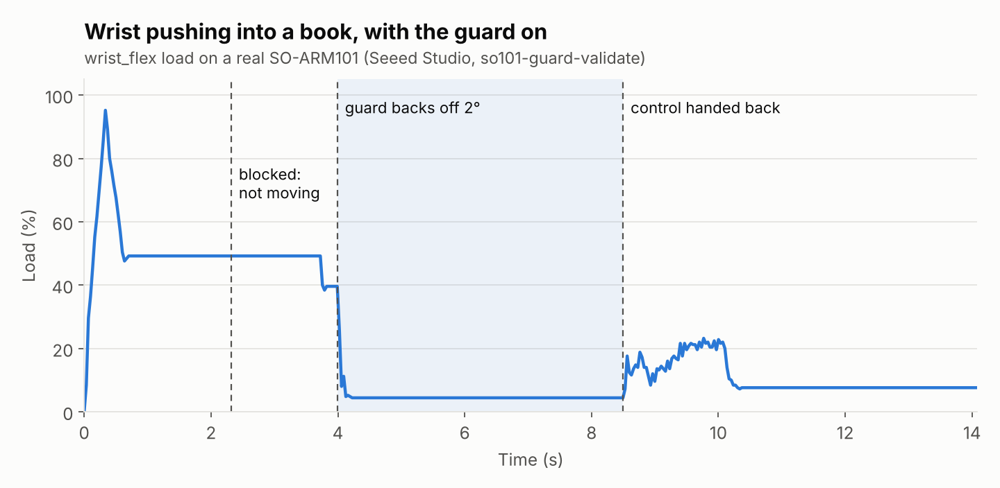

# bringup-check: An optional diagnostic and safety tool for SO-ARM101

## Introduction

[bringup-check](https://github.com/bluvtx09/bringup-check) is a free, open-source (MIT) tool built by Sunwoo Hwang, a high school student in Korea, for people bringing up an SO-ARM101 with LeRobot. Seeed Studio tested it on two real SO-ARM101 arms. It is an **optional companion**: it does not replace any part of the official LeRobot setup, and you can remove it at any time.

It has three parts:

| Part | When to use it | Moves the arm? |
|---|---|---|
| **Overload guard** | During teleoperation and recording | Only as LeRobot normally would. It eases a blocked joint back. |
| **Setup check** | Before the first teleoperation, or when something seems wrong | No. It only reads the servos. |
| **Dataset scan** | After recording your own teleoperation data | No robot needed |

### Why an overload guard?

A common way to damage a follower servo is a blocked joint during teleoperation, especially in a new user's first sessions. The follower is pressed against something, such as the table, a book or its own frame, while you keep moving the leader. The follower servo then pushes at high load without moving until it overheats.

LeRobot already protects the **gripper**: it limits the gripper servo to 50% of its maximum torque, and to 25% once the servo detects an overload. It does not do this for the **arm joints**. In one of Seeed's tests, a jammed wrist spent 13.4 of 30 seconds above 90% load while its position stayed within 0.05°. The guard covers this gap.

## Requirements

- An SO-ARM101 (or SO-100) with Feetech STS3215 servos.
- LeRobot already installed, and the follower arm already calibrated with `lerobot-calibrate`. Remember the `--robot.id` you used.
- Python 3.10 or newer.
- [Git](https://git-scm.com/downloads), because pip installs the tool from GitHub. (Without Git, see [Troubleshooting](#troubleshooting).)

The guard was tested on real arms with LeRobot 0.4.4 on a reComputer J4012, and in software with LeRobot 0.6 and 0.7.

## 1. Overload guard

### What it does

The guard is a drop-in LeRobot robot type, `so101_follower_guarded`. It takes the same arguments as `so101_follower`, reuses your existing calibration, and watches each motor's load, position and temperature every control cycle. It steps in only when a motor is **blocked**: high load, far from its goal, and not moving for about 1.5 seconds.

- **Arm joints** stop pushing and back off 2° from the obstacle.
- **The gripper** keeps a light grip just past the contact point, so the object is not dropped.
- A joint that is only **carrying the arm's weight** is left alone. The guard checks this with a small 2° probe before acting, so the arm does not droop.
- Control is handed back as soon as you move the leader away from the obstacle.
- A joint blocked in **both** directions at the same spot (seized, clamped, or a stuck position sensor) is reported as jammed and is not pushed more than 2° either way until it moves again.

### Install

Activate the Python environment where LeRobot runs, then install the plugin. It does not install, upgrade or replace LeRobot or torch, so a custom setup (for example a Jetson with NVIDIA's torch build) stays as it is.

```bash
pip install "git+https://github.com/bluvtx09/bringup-check#subdirectory=plugins/lerobot_robot_so101_guarded"
```

Check that it is installed in the same environment as LeRobot:

```bash
pip show lerobot_robot_so101_guarded
```

### Validate it on your arm (about 10 minutes)

Before you rely on the guard, run the guided validation on your follower arm. The leader is not needed.

You will need:

- A thick book or a box, for the wrist test.
- A soft object such as a sponge, for the gripper test.
- A free hand to support the arm when torque is off.

```bash
so101-guard-validate --port /dev/ttyACM0 --id my_arm
```

Replace `/dev/ttyACM0` with your follower's port (`lerobot-find-port` finds it) and `my_arm` with the id you used for `lerobot-calibrate`.

The script turns torque off on every motor and asks you to place the arm in the middle "L" pose used for calibration. Support the arm while torque is off. It then runs four tests, telling you what to do before each one:

| Test | What happens | What a pass means |
|---|---|---|
| `sweep` | Every joint moves slowly by a few degrees. | The guard stays out of normal motion. |
| `hold_pose` | You place the arm in a stretched-out pose, and it holds there. | The guard does not mistake the arm's weight for a block. |
| `wrist_block` | The wrist is commanded to push into the book. | The guard backs the wrist off. |
| `gripper_squeeze` | The gripper is commanded to squeeze the object harder. | The grip eases to a light hold without dropping the object. |

### What a good result looks like

At the end, the script prints one line per test and the name of a CSV log. A passing run looks like this. The `wrist_block` and `gripper_squeeze` lines come from Seeed's logs on a real SO-ARM101, read by the current version:

```
=== results ===
[PASS] sweep: 0 intervention(s) where none should happen
[PASS] hold_pose: 0 intervention(s) where none should happen
[PASS] wrist_block: wrist_flex back-off at 4.0 s
[PASS (SERVO LIMIT)] gripper_squeeze: no gripper intervention; the servo's own overload protection eased the squeeze: peak 50% load, then 20% with a 30.8% gap (LeRobot sets the gripper to 50% max torque and 25% when overloaded), so the guard did not need to step in
```

`PASS (SERVO LIMIT)` is a normal result on SO-ARM101. It means the gripper servo's own protection, which LeRobot sets up, eased the squeeze before the guard needed to.

The chart below shows that `wrist_block` test. The guard notices the block at 2.3 seconds, backs the wrist off at 4.0 seconds, and the load drops from about 50% to under 5%. When the command moves away from the book at 8.5 seconds, control is handed back.



Other results:

| Result | Meaning | What to do |
|---|---|---|
| `FAIL` | The test ran, but the guard did not behave as expected. | Open an issue and attach the CSV log. |
| `INCONCLUSIVE` | The test never got going, for example the object did not load the gripper. | Repeat the test, placing the object as the script describes. |
| `CHECK HARDWARE` | A joint did not move at all when commanded. It may be jammed, clamped or misassembled. | Check that joint by hand with torque off before teleoperating. |

You can summarize any guard log later with:

```bash
bringup-check --analyze-log guard_validation_YYYYMMDD_HHMMSS.csv
```


### Use it during teleoperation

Change only the robot type. All other arguments stay the same as with `so101_follower`:

```bash
lerobot-teleoperate \
  --robot.type=so101_follower_guarded --robot.port=/dev/ttyACM0 --robot.id=my_arm \
  --teleop.type=so101_leader --teleop.port=/dev/ttyACM1 --teleop.id=my_leader
```

It works the same way with `lerobot-record`. Two optional settings:

- `--robot.guard_mode=warn` only prints what the guard would do, without changing any command. This is useful for a first try.
- `--robot.guard_log=guard.csv` records every control cycle to a CSV file.

To go back to the stock behavior, use `--robot.type=so101_follower` again.

## 2. Setup check (optional)

A read-only check of wiring, power and calibration. It reads each servo's voltage, temperature, load, error flags and position limits, and explains likely setup faults in plain language: a broken daisy chain, a wrong or swapped power supply, a servo running hot, or a joint outside its calibrated range. Nothing moves and nothing is written to the servos.

```bash
pip install "bringup-check[hardware] @ git+https://github.com/bluvtx09/bringup-check"
bringup-check --port /dev/ttyACM0 --servo-rating 7.4 --calib auto
```

Use `--servo-rating 12` if your follower uses 12 V servos. `--calib auto` finds your LeRobot calibration file. A healthy arm looks like this:

```
Result: no setup problems found.

ID  joint          volt  temp  load  current  pos   torque  status
1   shoulder_pan   5.0V  31°C  0%    0mA      2040  off     ok
2   shoulder_lift  5.0V  32°C  0%    0mA      1180  off     ok
3   elbow_flex     5.0V  31°C  0%    0mA      2950  off     ok
4   wrist_flex     5.0V  30°C  0%    0mA      2300  off     ok
5   wrist_roll     5.0V  30°C  0%    0mA      2048  off     ok
6   gripper        5.0V  31°C  0%    0mA      2100  off     ok
```

When something is wrong, each finding is shown as `[PROBLEM]` or `[WARN]` with the motors involved and a suggested fix. To see every diagnosis on simulated faults without a robot, run `bringup-check --demo all`.

## 3. Dataset scan (for users who record teleoperation data)

A LeRobot dataset stores what the leader commanded (`action`) and where the follower actually was (`observation.state`). When the command stays far from the position while the joint does not move, the follower was blocked: the gripper was closed on an object, or a joint was pressed against something. The scan finds these moments, using the guard's own thresholds. No robot is needed.

```bash
pip install "bringup-check[dataset] @ git+https://github.com/bluvtx09/bringup-check"
bringup-check --scan-dataset lerobot/svla_so100_stacking
```

It accepts a dataset id on the Hugging Face Hub or a local dataset folder. Part of the output for the example above:

```
joint              holds   episodes    total s  longest    5s+   15s+
main_shoulder_pan       0     0 (  0%)      0.0     0.0      0      0
...
main_gripper           49    49 ( 89%)    199.8     6.1      5      0

Longest 10 holds:
  episode 41 · main_gripper · from 6.0 s for 6.1 s · max command-position gap 6.8 · pushing to close
  ...
```

How to read it:

- **Short gripper holds are normal grasps.** Long ones mean the leader kept squeezing well past the object.
- **Arm-joint holds** are worth checking in the episode video at the listed time. Some are real contact. Others come from calibration, for example a wrist_roll range that crosses the encoder's wrap point.
- Datasets record position only, not load or temperature, so a hold is a candidate, not proof that a servo strained.

For the analysis of 52 public SO-100/SO-101 datasets, see [the full write-up](https://github.com/bluvtx09/bringup-check/tree/main/studies/blocked-servos-2026-11).

## Troubleshooting

| What you see | What to do |
|---|---|
| `pip install` fails with a Git error | Install [Git](https://git-scm.com/downloads), or download the repository as a ZIP (**Code → Download ZIP**), unzip it and run `pip install --no-deps ./bringup-check-main/plugins/lerobot_robot_so101_guarded` for the guard, or `pip install "./bringup-check-main[hardware]"` for the setup check. |
| `lerobot-teleoperate` does not know `so101_follower_guarded` | The plugin is installed in a different Python environment. Activate LeRobot's environment and install it again. |
| `so101-guard-validate` says there is no calibration file | Use the same `--id` you gave `lerobot-calibrate`, or point to the folder with `--calibration_dir`. |
| `Cannot open port` | Close any other program using the port (another LeRobot terminal, a servo debug tool, the Arduino IDE). On Linux, run `sudo usermod -aG dialout $USER` and log in again. |
| A question asks whether to send the result | This is optional, and the default is no. Add `--no-send` to turn it off. |

## Limitations

- The guard's thresholds are starting points, tested on a few arms so far.
- The jammed-joint detection has been tested in software but has not yet been triggered on a real arm.
- Only Feetech STS serial-bus servos are supported.
- The dataset scan uses position only. It cannot measure load or temperature.

## Further reading and support

- Source code and full documentation: [github.com/bluvtx09/bringup-check](https://github.com/bluvtx09/bringup-check)
- Data analysis of 52 public datasets: [What 32 hours of public SO-101 data say about blocked servos](https://github.com/bluvtx09/bringup-check/tree/main/studies/blocked-servos-2026-11)
- Questions and bug reports: [open an issue](https://github.com/bluvtx09/bringup-check/issues/new) with the full output. Attaching your `guard_validation_*.csv` log helps tune the thresholds. The author is a student, so replies can take a few days.
