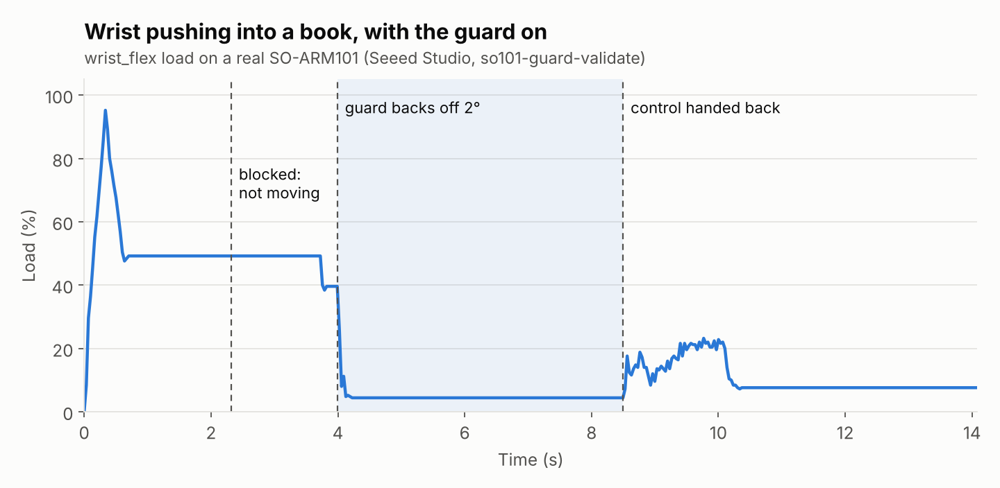

# bringup-check：SO-ARM101 可选的诊断与安全工具

## 简介

[bringup-check](https://github.com/bluvtx09/bringup-check) 是一款免费、开源（MIT 许可）的工具，由韩国高中生 Sunwoo Hwang 为使用 LeRobot 调试 SO-ARM101 的用户开发。Seeed Studio 已在两台真实的 SO-ARM101 上对它进行了测试。它是一个**可选的配套工具**：不会替换官方 LeRobot 设置中的任何部分，可以随时移除。

它包含三个部分：

| 部分 | 何时使用 | 会让机械臂运动吗？ |
|---|---|---|
| **过载保护** | 遥操作和录制数据时 | 只按 LeRobot 平时的方式运动，并让被卡住的关节回退。 |
| **安装检查** | 第一次遥操作之前，或感觉哪里不对时 | 不会，只读取舵机数据。 |
| **数据集扫描** | 录制自己的遥操作数据之后 | 不需要机械臂 |

### 为什么需要过载保护？

损坏从动臂舵机的一个常见原因，是遥操作时关节被卡住，尤其是在新用户最初几次操作时。从动臂顶在桌面、书本或自身结构上，而你仍在移动主动臂，于是从动臂舵机在不动的状态下以高负载持续顶推，直到过热。

LeRobot 已经保护了**夹爪**：它把夹爪舵机限制在最大扭矩的 50%，舵机检测到过载后再降到 25%。但**手臂关节**没有这样的限制。在 Seeed 的一次测试中，一个卡死的腕关节在 30 秒内有 13.4 秒负载高于 90%，而位置变化始终不超过 0.05°。过载保护正是用来弥补这一缺口的。

## 准备条件

- 一台使用飞特 STS3215 舵机的 SO-ARM101（或 SO-100）。
- 已安装 LeRobot，并已用 `lerobot-calibrate` 完成从动臂校准。请记住当时使用的 `--robot.id`。
- Python 3.10 或更高版本。
- [Git](https://git-scm.com/downloads)，因为 pip 需要从 GitHub 安装本工具。（没有 Git 的情况请参见[常见问题](#常见问题)。）

过载保护已在 reComputer J4012 上配合 LeRobot 0.4.4 在真实机械臂上测试，并在软件环境中配合 LeRobot 0.6 和 0.7 测试。

## 1. 过载保护

### 功能

过载保护是一个可直接替换的 LeRobot 机器人类型 `so101_follower_guarded`。它的参数与 `so101_follower` 完全相同，沿用你现有的校准文件，并在每个控制周期检查每个舵机的负载、位置和温度。只有当舵机**被卡住**时它才会介入：负载高、离目标位置远，并且约 1.5 秒没有移动。

- **手臂关节**停止顶推，并从障碍物处回退 2°。
- **夹爪**在刚好越过接触点的位置保持轻握，物体不会掉落。
- 只是在**承受手臂自重**的关节不会被干预。过载保护在动作前会先做一次 2° 的小幅试探来确认，所以手臂不会下垂。
- 一旦你把主动臂从障碍物方向移开，控制权就会立即交还。
- 如果一个关节在同一位置**两个方向**都被卡住（卡死、被夹住，或位置传感器卡住），会被报告为卡死，并且在它重新能动之前，两个方向都不会被推动超过 2°。

### 安装

先激活运行 LeRobot 的 Python 环境，再安装插件。它不会安装、升级或替换 LeRobot 和 torch，因此自定义环境（例如使用 NVIDIA torch 版本的 Jetson）会保持原样。

```bash
pip install "git+https://github.com/bluvtx09/bringup-check#subdirectory=plugins/lerobot_robot_so101_guarded"
```

确认它安装在与 LeRobot 相同的环境中：

```bash
pip show lerobot_robot_so101_guarded
```

### 在你的机械臂上验证（约 10 分钟）

在正式依赖过载保护之前，请先在从动臂上运行引导式验证。不需要主动臂。

你需要准备：

- 一本厚书或一个盒子，用于腕关节测试。
- 一个软物体（例如海绵），用于夹爪测试。
- 在扭矩关闭时，用一只手扶住机械臂。

```bash
so101-guard-validate --port /dev/ttyACM0 --id my_arm
```

请把 `/dev/ttyACM0` 换成从动臂的端口（可用 `lerobot-find-port` 查找），把 `my_arm` 换成你运行 `lerobot-calibrate` 时使用的 id。

脚本会关闭所有舵机的扭矩，并请你把机械臂摆到校准时使用的中间 "L" 形姿态。扭矩关闭期间请扶住机械臂。之后它会运行四项测试，每项开始前都会提示你该做什么：

| 测试 | 过程 | 通过代表什么 |
|---|---|---|
| `sweep` | 每个关节缓慢移动几度。 | 正常运动时过载保护不会介入。 |
| `hold_pose` | 你把机械臂摆成伸展姿态，它保持不动。 | 过载保护不会把手臂自重误认为卡住。 |
| `wrist_block` | 命令腕关节顶向书本。 | 过载保护让腕关节回退。 |
| `gripper_squeeze` | 命令夹爪更用力地夹紧物体。 | 夹持力降为轻握，物体不会掉落。 |

### 正常结果是什么样的

结束时，脚本会为每项测试打印一行结果，并给出 CSV 日志的文件名。通过时的输出如下。其中 `wrist_block` 和 `gripper_squeeze` 两行来自 Seeed 在真实 SO-ARM101 上的日志，由当前版本读取：

```
=== results ===
[PASS] sweep: 0 intervention(s) where none should happen
[PASS] hold_pose: 0 intervention(s) where none should happen
[PASS] wrist_block: wrist_flex back-off at 4.0 s
[PASS (SERVO LIMIT)] gripper_squeeze: no gripper intervention; the servo's own overload protection eased the squeeze: peak 50% load, then 20% with a 30.8% gap (LeRobot sets the gripper to 50% max torque and 25% when overloaded), so the guard did not need to step in
```

在 SO-ARM101 上，`PASS (SERVO LIMIT)` 是正常结果。它表示 LeRobot 为夹爪舵机设置的自身保护，在过载保护需要介入之前就已经减小了夹持力。

下图是这次 `wrist_block` 测试的情况。过载保护在 2.3 秒发现卡住，在 4.0 秒让腕关节回退，负载从约 50% 降到 5% 以下。8.5 秒时命令离开书本方向，控制权随即交还。



其他结果：

| 结果 | 含义 | 处理方法 |
|---|---|---|
| `FAIL` | 测试已运行，但过载保护的表现不符合预期。 | 提交 issue，并附上 CSV 日志。 |
| `INCONCLUSIVE` | 测试没有真正开始，例如物体没有让夹爪产生负载。 | 按脚本的提示摆放物体后重新测试。 |
| `CHECK HARDWARE` | 某个关节在收到命令后完全没有移动，可能卡死、被夹住或装配有误。 | 遥操作前，在扭矩关闭的状态下用手检查该关节。 |

之后也可以随时汇总任意过载保护日志：

```bash
bringup-check --analyze-log guard_validation_YYYYMMDD_HHMMSS.csv
```

### 在遥操作中使用

只需更改机器人类型，其他参数与 `so101_follower` 相同：

```bash
lerobot-teleoperate \
  --robot.type=so101_follower_guarded --robot.port=/dev/ttyACM0 --robot.id=my_arm \
  --teleop.type=so101_leader --teleop.port=/dev/ttyACM1 --teleop.id=my_leader
```

`lerobot-record` 的用法相同。两个可选设置：

- `--robot.guard_mode=warn`：只打印过载保护将要做什么，不修改任何命令。适合第一次试用。
- `--robot.guard_log=guard.csv`：把每个控制周期记录到 CSV 文件。

如果要恢复原来的行为，把类型改回 `--robot.type=so101_follower` 即可。

## 2. 安装检查（可选）

只读的接线、供电与校准检查。它读取每个舵机的电压、温度、负载、错误标志和位置限位，并用通俗的语言说明可能的安装问题：菊花链断开、电源不对或接反、舵机过热，或关节超出校准范围。不会让任何部件运动，也不会向舵机写入任何数据。

```bash
pip install "bringup-check[hardware] @ git+https://github.com/bluvtx09/bringup-check"
bringup-check --port /dev/ttyACM0 --servo-rating 7.4 --calib auto
```

如果从动臂使用 12 V 舵机，请改用 `--servo-rating 12`。`--calib auto` 会自动找到你的 LeRobot 校准文件。正常的机械臂输出如下：

```
Result: no setup problems found.

ID  joint          volt  temp  load  current  pos   torque  status
1   shoulder_pan   5.0V  31°C  0%    0mA      2040  off     ok
2   shoulder_lift  5.0V  32°C  0%    0mA      1180  off     ok
3   elbow_flex     5.0V  31°C  0%    0mA      2950  off     ok
4   wrist_flex     5.0V  30°C  0%    0mA      2300  off     ok
5   wrist_roll     5.0V  30°C  0%    0mA      2048  off     ok
6   gripper        5.0V  31°C  0%    0mA      2100  off     ok
```

发现问题时，每条结果会标为 `[PROBLEM]` 或 `[WARN]`，并列出相关舵机和建议的处理方法。如果想在没有机械臂的情况下看到所有诊断在模拟故障上的效果，运行 `bringup-check --demo all`。

## 3. 数据集扫描（适用于录制遥操作数据的用户）

LeRobot 数据集记录了主动臂发出的命令（`action`）和从动臂的实际位置（`observation.state`）。如果命令与位置长时间相差很大而关节又没有移动，说明从动臂被卡住了：夹爪已经夹住物体，或某个关节顶在了东西上。扫描器使用与过载保护相同的阈值来查找这些时刻，不需要机械臂。

```bash
pip install "bringup-check[dataset] @ git+https://github.com/bluvtx09/bringup-check"
bringup-check --scan-dataset lerobot/svla_so100_stacking
```

它可以接受 Hugging Face Hub 上的数据集 id，也可以接受本地数据集文件夹。上面示例的部分输出：

```
joint              holds   episodes    total s  longest    5s+   15s+
main_shoulder_pan       0     0 (  0%)      0.0     0.0      0      0
...
main_gripper           49    49 ( 89%)    199.8     6.1      5      0

Longest 10 holds:
  episode 41 · main_gripper · from 6.0 s for 6.1 s · max command-position gap 6.8 · pushing to close
  ...
```

如何解读：

- **夹爪的短时卡住是正常的抓取。**时间很长的卡住，说明主动臂在越过物体之后仍在用力夹。
- **手臂关节的卡住**值得到对应片段的视频里、按列出的时间点查看。有些是真实接触，有些则来自校准问题，例如 wrist_roll 的范围跨越了编码器的回绕点。
- 数据集只记录位置，不记录负载和温度，所以扫描结果只是"可能的卡住"，并不能证明舵机真的承受了过载。

关于 52 个公开 SO-100/SO-101 数据集的分析，请参阅[完整文章](https://github.com/bluvtx09/bringup-check/tree/main/studies/blocked-servos-2026-11)（英文）。

## 常见问题

| 现象 | 处理方法 |
|---|---|
| `pip install` 报 Git 相关错误 | 安装 [Git](https://git-scm.com/downloads)；或者把仓库下载为 ZIP（**Code → Download ZIP**）并解压，过载保护运行 `pip install --no-deps ./bringup-check-main/plugins/lerobot_robot_so101_guarded`，安装检查运行 `pip install "./bringup-check-main[hardware]"`。 |
| `lerobot-teleoperate` 不认识 `so101_follower_guarded` | 插件装在了另一个 Python 环境中。请激活 LeRobot 所在的环境后重新安装。 |
| `so101-guard-validate` 提示找不到校准文件 | 使用与 `lerobot-calibrate` 相同的 `--id`，或用 `--calibration_dir` 指定校准文件夹。 |
| `Cannot open port` | 关闭其他占用该端口的程序（另一个 LeRobot 终端、舵机调试工具、Arduino IDE）。Linux 下运行 `sudo usermod -aG dialout $USER`，然后重新登录。 |
| 出现是否发送结果的提问 | 这是可选的，默认不发送。加上 `--no-send` 可关闭此提问。 |

## 局限性

- 过载保护的阈值目前只是起点，只在少数几台机械臂上测试过。
- 卡死关节检测已在软件中测试，但尚未在真实机械臂上被触发过。
- 只支持飞特 STS 系列串行总线舵机。
- 数据集扫描只使用位置数据，无法测量负载或温度。

## 延伸阅读与支持

- 源代码和完整文档：[github.com/bluvtx09/bringup-check](https://github.com/bluvtx09/bringup-check)
- 52 个公开数据集的数据分析（英文）：[What 32 hours of public SO-101 data say about blocked servos](https://github.com/bluvtx09/bringup-check/tree/main/studies/blocked-servos-2026-11)
- 问题与 bug 反馈：请[提交 issue](https://github.com/bluvtx09/bringup-check/issues/new)，并附上完整输出。附上你的 `guard_validation_*.csv` 日志有助于调整阈值。作者是学生，回复可能需要几天时间。
