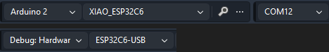
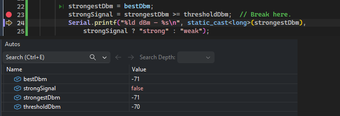

This walkthrough builds on the XIAO ESP32C6 [Wi-Fi scan example](https://wiki.seeedstudio.com/xiao_wifi_usage_esp32c6/#scan-nearby-wifi-networks). You’ll upload an Arduino sketch that classifies the strongest sampled 2.4 GHz signal, then stop at the comparison and see the value change as you step through it. The XIAO’s built-in USB JTAG works through the same USB data cable you use to upload the sketch. [Espressif’s built-in USB JTAG reference](https://docs.espressif.com/projects/esp-idf/en/stable/esp32c6/api-guides/jtag-debugging/configure-builtin-jtag.html)

## What you need

- A Seeed Studio XIAO ESP32C6 and a USB-C data cable connected directly to your Windows computer.
- Microsoft Visual Studio 2022 or 2026 with the **Desktop development with C++** workload and the [Visual Micro extension](https://marketplace.visualstudio.com/items?itemName=VisualMicro.ArduinoIDEforVisualStudio). Visual Micro is a third-party extension with a trial and paid licences.
- An active 2.4 GHz Wi-Fi access point in range. The sketch scans nearby networks without joining them.

## Select the board and port

1. In the Visual Micro toolbar, select the Arduino environment you want to use. The **Arduino 2** option uses your Arduino IDE 2 configuration. If **esp32 by Espressif Systems** is already installed in that environment, go to step 2. Otherwise, use **Micro Explorer → Board Manager** to install the stable package. If Espressif is missing from Board Manager, add the package index from Seeed’s instructions in **IDE Locations → Additional board manager JSON URLs**, save and choose **Check for Updates** in Board Manager. [Seeed’s board setup](https://wiki.seeedstudio.com/xiao_esp32c6_getting_started/#add-board) · [Visual Micro Board Manager](https://www.visualmicro.com/page/User-Guide.aspx?doc=Board-Manager.html)
2. Choose **vMicro → New Arduino Project** and name it `XiaoC6WifiSignal`. Select `XIAO_ESP32C6` as the board and the COM port that appears when you connect the XIAO.
3. Set **USB CDC On Boot** to **Enabled** in **vMicro → Board Options**. This routes the sketch’s `Serial` output to the XIAO’s USB connector.

## Upload the Wi-Fi sketch

Replace the contents of `XiaoC6WifiSignal.ino` with the sketch below. It scans for networks, records the strongest sampled RSSI in dBm, and compares it with `-70 dBm`. A reading of `-70 dBm` or higher counts as strong.

```cpp
#include <WiFi.h>

volatile int32_t thresholdDbm = -70;
volatile int32_t strongestDbm = -127;
volatile bool strongSignal = false;

void setup() {
  Serial.begin(115200);
  WiFi.STA.begin(false);
}

void loop() {
  const int count = WiFi.scanNetworks();

  if (count > 0) {
    // WiFi.RSSI() takes an 8-bit scan-result index.
    const int sampleCount = min(count, 256);
    int32_t bestDbm = WiFi.RSSI(0);
    for (int index = 1; index < sampleCount; ++index) {
      const int32_t rssi = WiFi.RSSI(index);
      if (rssi > bestDbm) {
        bestDbm = rssi;
      }
    }

    strongestDbm = bestDbm;
    strongSignal = strongestDbm >= thresholdDbm;  // Set a breakpoint here.
    Serial.printf("%ld dBm (%s)\n", static_cast<long>(strongestDbm),
                  strongSignal ? "strong" : "weak");
  } else {
    Serial.println(count == 0 ? "No networks found" : "Wi-Fi scan failed");
  }

  WiFi.scanDelete();
  delay(4000);
}
```

Choose **vMicro → Build & Upload**. Open the Visual Micro **Serial Monitor** for the board’s COM port, set it to **115200 baud** and click **Connect**. After a scan, expect a line such as `-68 dBm (strong)` or `-71 dBm (weak)`. Enable **Auto-Recon** if you want an open monitor to reconnect after the port is released by a later upload.

## Step through the signal comparison

1. Select the **Debug** build configuration. In the Visual Micro toolbar, set the debugger mode to **Hardware** and choose **ESP32C6-USB**. Keep the board set to `XIAO_ESP32C6`. To match the board test, select **vMicro → Debugger → Disable Optimization → No Project + Libraries Optimization**.

   

2. Click in the left margin of the line `strongSignal = strongestDbm >= thresholdDbm;` to set a breakpoint. Press **F5** to start debugging. The sketch pauses on that line once a scan finds a network.
3. In Visual Studio, open **Debug → Windows → Watch → Watch 1**. Add `strongestDbm`, `thresholdDbm` and `strongSignal`. At this point, `strongSignal` still holds its previous value.
4. Press **F10** once to execute the comparison. The debugger moves to the `Serial.printf` line. In the board test shown below, `strongestDbm` was `-71`, `thresholdDbm` was `-70`, and the assignment changed `strongSignal` from `true` to `false`. Your result will depend on the networks around you. The screenshot shows the values in **Autos**.

   

5. Press **F5** to resume. The Serial Monitor prints the classification. The sketch then waits four seconds and starts another scan. To leave it scanning without pausing, clear the breakpoint and press **F5** again.

The screenshots show the original on-board test. The sketch above uses the same comparison and limits the number of scan results it indexes to 256. That revision was compiled with Arduino-ESP32 3.3.13.

## Troubleshooting

- **The breakpoint never hits.** The comparison runs only when the scan finds at least one network. If the Serial Monitor says `No networks found`, move the XIAO closer to a 2.4 GHz access point. If you need to connect the monitor manually while the sketch is paused, resume with **F5** before clicking **Connect**.
- **The COM port is missing or the upload times out.** Check that the cable carries data, reconnect the board and select the current COM port. If Windows still does not detect it, follow [Seeed’s bootloader recovery steps](https://wiki.seeedstudio.com/xiao_esp32c6_getting_started/#bootloader-mode).
- **USB JTAG disconnects or the debugger stalls.** Unplug and reconnect the XIAO, then wait for Windows to recognise it. If the debugger is still waiting, stop debugging and start a fresh session with **F5**. For OpenOCD errors or debugger profile checks, see [ESP32-C6 USB JTAG troubleshooting](https://www.visualmicro.com/page/ESP32C6-USB-Debugging.aspx#usb-jtag-troubleshooting).

## See also

- [XIAO ESP32C6 with PlatformIO](https://wiki.seeedstudio.com/xiao_esp32c6_with_platform_io/)
- [Wi-Fi usage on XIAO ESP32C6](https://wiki.seeedstudio.com/xiao_wifi_usage_esp32c6/)
